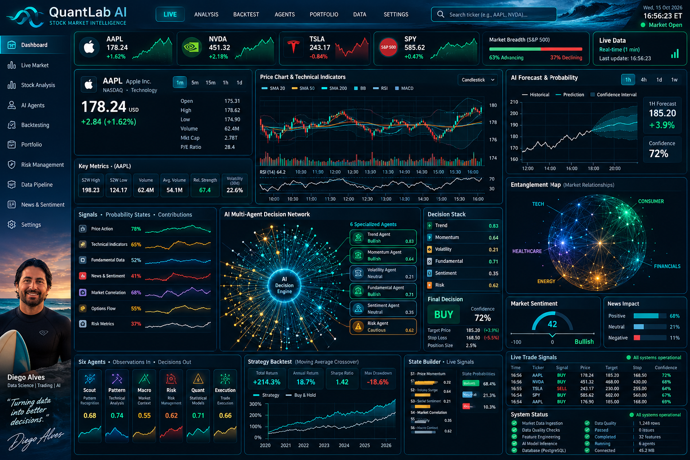

# ◈ QuantLab AI — Deep Ocean Quant Terminal



> **Design concept:** This image is illustrative artwork, not a screenshot of the functioning Streamlit application. The actual app is implemented in `app.py`.

### Founder — Diego Allan Alves


**Data Engineer · Data Scientist · Independent Developer**  
MSc Data Science, London South Bank University. Building practical data and AI portfolio projects with Python, SQL, machine learning and interactive analytics.

[GitHub](https://github.com/diegoallanalves)

<br clear="all" />


A functional, high-density Streamlit stock-market research dashboard inspired by institutional quantitative terminals. The original UI uses deep navy, electric cyan, seafoam green and amber. It focuses on **AAPL, NVDA, TSLA and SPY**.

## What's implemented

- Four ticker overview cards and a selected-instrument market overview
- Interactive candlestick/volume/RSI chart with SMA 20/50/200 overlays
- Six transparent rule-based analytical agents (trend, momentum, MACD, volume, volatility, risk)
- A large, deterministic radial decision-network visualization inspired by the reference design
- Explainable BUY/HOLD/SELL **research signals** (not trade recommendations)
- SMA 20/50 crossover backtest with next-bar execution, transaction fees and slippage
- Data-quality checks and downloadable CSV outputs
- Offline, reproducible synthetic demo data; optional historical daily market data from Yahoo Finance
- **Auto-refresh options: 15 seconds, 1 minute, 15 minutes, 30 minutes, or 1 hour**
- Optional latest-available **1-minute intraday candlestick chart** for the selected ticker (Yahoo Finance; provider delays apply)

**Important:** This is a working MVP, not a real self-learning AI trading system. The orb is a visualization of simulated feature nodes, not a learned neural network. The six agents are rules, not autonomous LLMs. There are no real trades, news sentiment feeds, options flow, PostgreSQL connections or trained forecasts in v1. The app never fabricates live prices when the data provider is unavailable.

## Quick start (Windows PowerShell)

```powershell
cd QuantLab_AI
py -m venv .venv
.\.venv\Scripts\Activate.ps1
python -m pip install --upgrade pip
python -m pip install -r requirements.txt
python -m streamlit run app.py
```

Open http://localhost:8501 and choose **Synthetic demo (offline)** or **Historical market data (Yahoo Finance)**.

For macOS/Linux, activate with `source .venv/bin/activate` and use `python3` if needed.

## Tests

```bash
python -m pytest -q
```

## Project structure

```text
QuantLab_AI/
├── app.py                  # Streamlit terminal UI
├── quantlab/
│   ├── __init__.py
│   ├── data.py             # Offline demo and optional Yahoo data
│   ├── analytics.py        # Indicators, agents, backtesting
│   └── visuals.py          # Plotly charts and radial network
├── tests/
│   └── test_analytics.py
├── requirements.txt
├── .streamlit/config.toml
└── .gitignore
```

## Methodology and limitations

- **Daily and intraday data:** Historical OHLCV plus optional 1-minute bars; polling does not guarantee live prices. `SPY` is an ETF proxy for the S&P 500.
- **Signal score:** Mean of six normalized rule scores, thresholds ±0.18. Not a probability or calibrated prediction.
- **Backtest:** Long-only SMA20/SMA50 signal formed at close, applied to next close-to-close return; 5 bps fee + 3 bps slippage per position change. This is simplified, in-sample research, without taxes or market impact.
- **Data quality:** Missing values, duplicate dates, invalid price bars.
- **Demo mode:** All prices, returns and backtest outcomes are synthetic; do not interpret them as real market results.
- **Live provider:** Yahoo Finance availability, latency and access can vary; download errors are displayed instead of silently switching to demo data.

## Next iterations

PostgreSQL historical storage; configurable strategies; walk-forward testing; corporate-action/benchmark handling; model training with proper time-series validation; paper-trading journal; optional real-time data via licensed provider; automated tests and Docker deployment.

Created as an educational Data Engineering + Quantitative Analytics portfolio project.

## Refresh controls

Select **Auto-refresh** at the top of the app: **15 seconds**, **1 minute**, **15 minutes**, **30 minutes**, or **1 hour**. The 15-second setting is intended for occasional observation; frequent polling may be rate-limited by the data provider. This controls how often the Streamlit page reruns, not the timeframe of the technical indicators (which remain based on daily historical bars). For Yahoo Finance mode, a separate 1-minute candlestick panel shows the latest available intraday bars. The provider may delay quotes or have no bars outside trading hours. Offline demo mode remains static and reproducible by design.

## Continuous animated decision orb

The decision orb uses an embedded HTML Canvas animation. It smoothly animates 950 illustrative observation nodes, six signal waveforms, and traveling pulses using the browser's `requestAnimationFrame`. It is intentionally **visual only**: no fabricated ticks, prices, orders, or artificial model updates. Data polling remains controlled by the separate 15-second / 1-minute / 15-minute / 30-minute / 1-hour auto-refresh selector. For accessibility, the animation stops when reduced-motion is requested. Background tabs suspend drawing.
